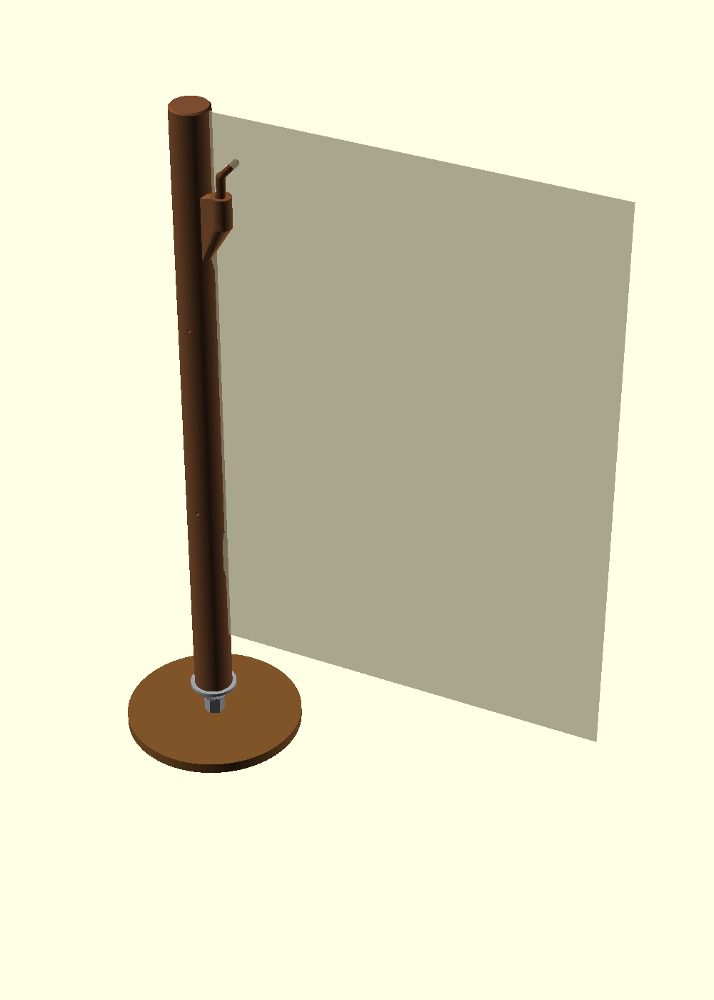
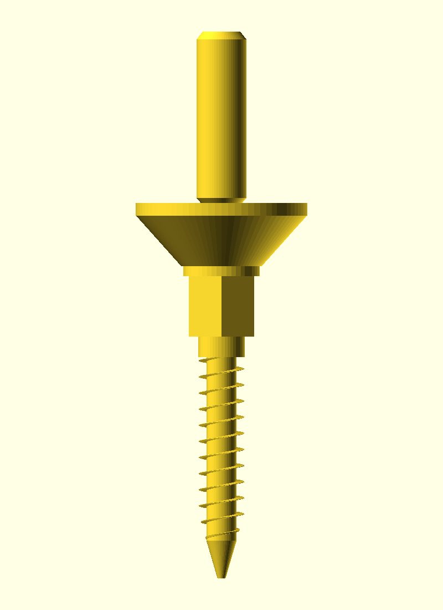

# A3-mast



Mast om een A3 tegenaan te hangen, in de trant van de inkeping op het voorbeeld.
De mast heeft **twee gleuven**. Onderaan staat hij los op een **punt-houtschroef** en kan hij draaien.
Een losse pen door een ponsgat is de stop als het vel omlaag glijdt.

Drie printbare delen van 170 mm, plus de schroef en de pen. `mast-enkel.stl` is hetzelfde in één stuk (470 mm hoog).



## Onderdelen

| Bestand | Wat | Print |
|---|---|---|
| `mast-onder.stl` | boring + onderste gleuf | staand, boring op het bed, zonder support |
| `mast-midden.stl` | tussenstuk | staand, bus op het bed, zonder support |
| `mast-boven.stl` | bovenste gleuf + nok voor de pen | staand, bus op het bed, zonder support |
| `schroef.stl` | punt, houtschroefdraad, zeskant 13, draaipen | **punt op het bed**, met brim, zonder support |
| `pen.stl` | L-pen voor het ponsgat | plat op het bed, met brim |
| `mast-enkel.stl` | mast uit één stuk | alleen als de printer minstens 470 mm hoog is |

Laaghoogte 0,20 mm. Mast: 4 wanden, 20% vulling. Schroef: 100% vulling of 6 wanden (PLA of liever PETG).

## Maten

- Mast Ø 28 mm, 470 mm hoog. Gleuf 11 mm diep, 4 mm spleet.
- Onderste gleuf rond 120 mm hoogte, bovenste rond 372 mm.
- Draaipen Ø 10 × 34 mm. Boring in de mast Ø 10,8 mm.
- Houtschroef Ø 9 mm, spoed 3,2 mm, punt eraan. Steeksleutel 13.
- De kegel onder de flens is steiler dan 45°, daarom print de schroef zonder support met de punt omlaag.

## In elkaar

1. Voorboren in het hout: vuren/grenen Ø 5,5 mm, harder hout Ø 6 à 6,5 mm, diepte ± 50 mm. Een ring M10 onder de zeskant mag.
2. Schroef erin draaien tot de zeskant op het hout zit. De draaipen blijft boven de flens uit.
3. De drie mastdelen op elkaar. Draai tot de pengaten samenvallen — de gleuven wijzen dan dezelfde kant op. Borg elk gat met ± 35 mm filament van 1,75 mm. Te strak: even naboren met 2 mm.
4. Mast over de draaipen schuiven. Hij zakt tot op de flens en draait. Kneep hij: draaipen licht opschuren.

## Test met een A3 (staand)

De gleuven wijzen naar de kant waar het vel hangt. De linkerrand van het A3 gaat daarin.

**Test 1, alleen de gleuven.** Duw de linkerrand in beide gleuven, ongeveer 11 mm diep. Tussen de gleuven ligt het vel tegen de mast; het mag daar licht bol staan. Kijk of het blijft hangen of naar beneden glijdt.

**Test 2, ponsgat als stop.** Eén gat Ø 6 mm met een gewone perforator:

- 24 mm vanaf de linkerrand
- 38 mm vanaf de bovenrand

De bovenrand van het vel komt dan 2 mm onder de top van de mast. De onderrand hangt ongeveer 48 mm boven de flens, vrij van het blad.

Steek de dunne arm van achteren door het gat (de dikke nek blijft achter het vel) en laat de steel in de nok zakken. Het gat kan niet langs de pen omlaag, de gleuven houden de rand op zijn plaats.

## Aanpassen

Alle maten staan bovenaan `a3-mast.scad`. Opnieuw exporteren:

```sh
./export.sh
```

`boring_speling` is de diametrale speling op de draaipen (nu 0,80 mm). `gleuf_spleet` is de breedte van de inkeping (nu 4 mm).
